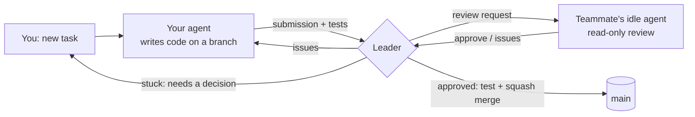

# Agent Review Hub — Quorum

**Your coding agent writes it. A teammate's agent reviews it. Only approved work reaches `main`.**

**[Website](https://quorum-agent-review.lovable.app)** · **[Demo video](https://quorum-agent-review.lovable.app/#demo)** ·
**[Download](https://quorum-agent-review.lovable.app/#download)** · [Releases](https://github.com/K0NSTANT1N3/agent-review-hub/releases)

[](https://quorum-agent-review.lovable.app/#demo)

*Watch the 95-second demo on the [website](https://quorum-agent-review.lovable.app/#demo), or open the
[video file](docs/media/quorum-demo.mp4). It was recorded in the real desktop app. Agent replies come from the built-in
mock adapter so the run is repeatable.*

Quorum is a desktop app for teams where everyone uses a coding agent (Claude Code, or opencode). When you give your
agent a task, the result isn't handed straight back to you: a small coordinator — the **Leader** — sends it to an
available teammate's agent for review, routes the critique back to *the same* author session, repeats until the
reviewer approves, then runs the tests and squash-merges into `main`.



* **Strict pairing** — each review is a conversation between exactly one author session and one reviewer session;
  messages never leak between tasks, and a busy session never receives unrelated work.
* **Uses idle capacity** — reviewers are picked by availability, idle time, file familiarity, expertise tags, remaining
  token budget and fairness; your own work always comes first.
* **Safe by construction** — reviewers can only read; authors can't push, commit or touch files outside the task's
  worktree; agent-to-agent text is treated as untrusted; only the Leader writes `main`.
* **Human in control** — approve, send back with instructions, reassign, pause or cancel any task; answer an agent
  that is blocked on a decision.

## Getting started

👉 **[Install and use Quorum](docs/INSTALL.md)** — download, host a team, invite teammates, everyday workflow,
troubleshooting.

In short: one person clicks **Host a team** (their app runs the Leader) and sends **join codes**; everyone else clicks
**Join a team**. Each app runs that person's agent in the background.

## Status

**v0.1 — feature complete.** Leader, agent Node, desktop app, installers and release pipeline are done; 27/27
end-to-end scenarios pass in CI, and a real Claude Code → Claude Code review-and-merge was verified. See
[tasks/STATUS.md](tasks/STATUS.md) for the build history and what's next.

## Repository layout

| Path | What |
|---|---|
| `packages/protocol` | Shared contract: config schemas, WebSocket frames, commands/events, agent output, REST routes (zod) |
| `packages/leader` | The Leader: SQLite state, task state machine, scheduler, locks/leases, merge worker, REST + WebSocket server, CLI |
| `packages/node` | The agent Node: git worktrees, journal, prompts, Claude Code / opencode / mock adapters, Leader client, CLI |
| `packages/desktop` | Electron + React app (Host/Join, dashboard, tasks, diffs, invites) and installer packaging |
| `e2e` | End-to-end scenarios running a real Leader and Nodes with scripted mock agents against real git |
| `docs/implementation-spec.md` | The authoritative design spec (codename "Quorum") |
| `docs/INSTALL.md` | User guide |

## Developing

```bash
corepack pnpm install
corepack pnpm -r build && corepack pnpm -r typecheck && corepack pnpm -r lint && corepack pnpm -r test
corepack pnpm e2e                               # full end-to-end suite (mock agents, real git)
corepack pnpm --filter @quorum/desktop dev      # run the desktop app from source
corepack pnpm --filter @quorum/desktop dist     # build installers for this OS
```

Releases: push a `vX.Y.Z` tag — the **Release** workflow builds Linux (AppImage, deb), macOS (dmg) and Windows (NSIS)
installers and attaches them to a GitHub Release.

Contributions: read [CONTRIBUTING.md](CONTRIBUTING.md) and [tasks/STATUS.md](tasks/STATUS.md). Where documents
disagree, [docs/implementation-spec.md](docs/implementation-spec.md) is authoritative.
