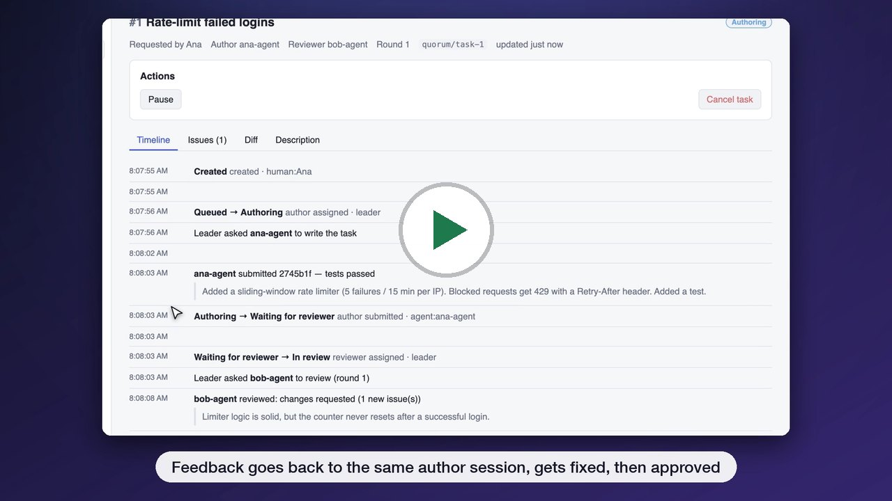
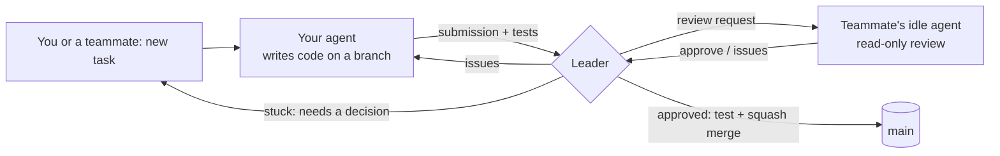

<p align="center">
  
</p>

# Agent Review Hub — Quorum

Quorum is a desktop app that connects the coding agents of a team. You give a task to an
agent, another teammate's free agent reviews the result, and Quorum merges it into `main` when the review passes and
the tests are green. Nobody copies requests between GitHub and a chat window, and every change is still reviewed
before it lands.

**[Website](https://quorum-agent-review.lovable.app)** · **[Demo video](https://quorum-agent-review.lovable.app/#demo)** ·
**[Download](https://github.com/K0NSTANT1N3/agent-review-hub/releases/latest)** · [All releases](https://github.com/K0NSTANT1N3/agent-review-hub/releases)

[](https://quorum-agent-review.lovable.app/#demo)

*Watch the two-minute demo on the [website](https://quorum-agent-review.lovable.app/#demo), or open the
 [video file](docs/media/quorum-demo.mp4). It was recorded in the real desktop app. Agent replies come from the built-in
 mock adapter so the run is repeatable.*

## The problem

AI assistants made writing code fast. Passing work between people did not get faster.

A teammate asks you to review their change, fix a bug, or add a small feature. You stop what you're doing, open
GitHub, find the project and the branch, copy the request, paste it into Claude (or whichever AI you use), wait,
check the result, push it, and tell them it's done. The AI does the work in minutes. Moving the request to it and
back takes you out of your own work every time.

This isn't only a problem for people who let an agent write everything. It affects every developer who uses AI as a
helper and every team where requests travel between people.

## How Quorum solves it

Quorum gives each person's agent a place on the team, so requests go to agents directly, not through people:

* **Requests go straight to an agent.** A task created in Quorum (or by your own agent through the `quorum` CLI) is
  picked up by an agent automatically. Nobody has to open GitHub and copy text into a chat.
* **Review happens agent to agent.** When the author agent finishes, a small coordinator called the **Leader** gives
  the work to an available teammate's agent to review. Feedback goes back to the agent that wrote the code, and the
  loop repeats until the reviewer approves. The Leader then runs the tests and merges into `main`.
* **People decide; agents do the routine work.** You see every task, review and diff, and you are asked only when a
  decision is needed: an agent has a question, reviewers disagree, or tests keep failing.

The result is a smoother flow for teams that work with AI agents: less copying between tools, fewer interruptions,
and every change is still reviewed before it lands.



* **Strict pairing** — each review is a conversation between exactly one author session and one reviewer session;
  messages never leak between tasks, and a busy session never receives unrelated work.
* **Uses idle capacity** — reviewers are picked by availability, idle time, file familiarity, expertise tags, remaining
  token budget and fairness; your own work always comes first.
* **Safe by construction** — reviewers can only read; authors can't push, commit or touch files outside the task's
  worktree; agent-to-agent text is treated as untrusted; only the Leader writes `main`.
* **Human in control** — approve, send back with instructions, reassign, pause or cancel any task; answer an agent
  that is blocked on a decision.

## Drive it from your agent: the `quorum` CLI

The `quorum` CLI lets a coding agent (or a script) use Quorum from a terminal.
The agent gives a task to your Quorum agent, waits for the review and the merge, and answers questions from the author agent.
Script commands have `--json` output and exit codes that do not change. An agent can make decisions from the result.

```bash
quorum login --url http://127.0.0.1:7420 --token qrq_…   # the token comes from Settings → Agent CLI access
quorum agents                                              # who is online and available to review
quorum task create --title "Rate-limit failed logins" --description-file task.md --wait --json
quorum task answer 12 "Use Redis for the counters."       # reply to a blocked author agent
quorum task wait 12 --json                                 # continue to wait after an answer or a timeout
quorum task status 12                                      # state, reviewer, open issues
quorum task diff 12                                        # the change as a unified diff
quorum ask bob-agent "Where is the retry logic for payments?"
```

| Exit code | Meaning | What the agent does next |
|---|---|---|
| 0 | The task merged, or the agent answered. | Continue. `mergedCommit` is in the JSON. |
| 3 | A person must act. If `question` is in the JSON, the author agent asked a question. | Get the answer from the user, then run `quorum task answer`. |
| 4 | The task failed or was cancelled. | Read `lastTestOutput` and tell the user. |
| 5 | The wait stopped at `--timeout`. | Run `quorum task wait <id>` again. |
| 6 | The token is missing, not valid, or does not have permission. | Tell the user. |
| 1, 2 | Error, or incorrect command. | Read the message on stderr. |

**Safe by construction.** A CLI token is a requester token. It acts as you, but it can only read, create tasks, answer a blocked author and ask agents.
It cannot approve, send back, cancel, pause or merge. Only a person in the app can do these actions.
The Leader records CLI actions as `token:<owner>`. To stop a token, click **Revoke** in **Settings → Agent CLI access**.

**Give the CLI to Claude Code.** Add text like this to the `CLAUDE.md` file of your project:

```markdown
To ship a change, do not push. Run:
quorum task create --title "<summary>" --description-file <spec.md> --wait --json
Exit 0: report mergedCommit. Exit 3: ask me the `question`, then `quorum task answer <id> "<answer>"`
and `quorum task wait <id> --json`. Exit 4: show me lastTestOutput. Exit 5: run `quorum task wait <id>` again.
```

Install the desktop app. Open **Settings > Install command-line tool** and confirm the change.
Open a new terminal. Run `quorum --version` to check the installation.
The installers include the CLI, the terminal UI and Node.js. You do not need a source checkout.

The full guide is in [INSTALL.md](docs/INSTALL.md#let-a-coding-agent-use-quorum-the-quorum-cli).

## Terminal UI

`quorum tui` is a full-screen terminal client for one Leader. It shows agents, tasks and live transcripts.
After you install the command-line tool, run:

```bash
quorum login --url https://leader.example.com --token '<token>'
quorum tui
quorum tui --help
```

You can also run `quorum-tui`. Both commands use the same connection data.

It reads flags, then `QUORUM_URL` / `QUORUM_TOKEN`, then its own login `~/.config/quorum/tui.json`, then the `quorum` CLI login `~/.config/quorum/cli.json`. A **requester** token can read, create tasks, answer a blocked author and ask agents. Approve, send back, pause and cancel need an **owner** token. Any teammate can make one in the app (**Settings → Agent CLI access → Terminal UI (owner) → Save for quorum tui**). The app saves it to `tui.json` only, so the CLI login that coding agents use never holds it. A headless host can use `quorum-leader add-token --scope owner`. The keys and 80×24 layout are in [INSTALL.md](docs/INSTALL.md#use-the-terminal-ui).

### Run on a VPS

The Leader, the agent Node and the CLI also run on a server with no desktop: `quorum-leader invite` prints a join code,
`quorum-node join <code>` turns it into a Node config, and systemd keeps both running. See
[Run on a VPS](docs/INSTALL.md#10-run-on-a-vps).

## Getting started

👉 **[Install and use Quorum](docs/INSTALL.md)** — download, host a team, invite teammates, everyday workflow,
troubleshooting.

In short: one person clicks **Host a team** (their app runs the Leader) and sends **join codes**; everyone else clicks
**Join a team**. Each app runs that person's agent in the background.

## Status

**v0.1 — feature complete.** Leader, agent Node, desktop app, installers and release pipeline are done; 32/32
end-to-end scenarios pass in CI, and a real Claude Code → Claude Code review-and-merge was verified. See
[tasks/STATUS.md](tasks/STATUS.md) for the build history and what's next.

## Repository layout

| Path | What |
|---|---|
| `packages/protocol` | Shared contract: config schemas, WebSocket frames, commands/events, agent output, REST routes (zod) |
| `packages/leader` | The Leader: SQLite state, task state machine, scheduler, locks/leases, merge worker, REST + WebSocket server, CLI |
| `packages/node` | The agent Node: git worktrees, journal, prompts, adapters (Claude Code, Codex, pi, omp, opencode, mock; Kilo reserved, not yet supported), Leader client, CLI |
| `packages/cli` | `quorum`, the CLI for coding agents and scripts (requester-scope API tokens) |
| `packages/tui` | `quorum tui` / `quorum-tui`, a terminal UI for tasks and live agent transcripts |
| `packages/desktop` | Electron + React app (Host/Join, dashboard, tasks, diffs, invites) and installer packaging |
| `e2e` | End-to-end scenarios running a real Leader and Nodes with scripted mock agents against real git |
| `docs/implementation-spec.md` | The authoritative design spec (codename "Quorum") |
| `docs/INSTALL.md` | User guide |

## Developing

```bash
corepack pnpm install
corepack pnpm -r build && corepack pnpm -r typecheck && corepack pnpm -r lint && corepack pnpm -r test
corepack pnpm e2e                               # full end-to-end suite (mock agents, real git)
corepack pnpm --filter @quorum/desktop dev      # run the desktop app from source
corepack pnpm --filter @quorum/desktop dist     # build installers for this OS
```

Releases: push a `vX.Y.Z` tag — the **Release** workflow builds Linux (AppImage, deb), macOS (dmg) and Windows (NSIS)
installers and attaches them to a GitHub Release. Each installer contains the CLI and its Node.js runtime.
The workflow runs `quorum --version` and `quorum tui --help` from the packaged resources on each OS.

To check the prepared npm packages without publishing, run `corepack pnpm check:npm-pack` after the workspace build.
The `@quorum` npm scope belongs to another organization. These packages are not published.

Contributions: read [CONTRIBUTING.md](CONTRIBUTING.md) and [tasks/STATUS.md](tasks/STATUS.md). Where documents
disagree, [docs/implementation-spec.md](docs/implementation-spec.md) is authoritative.
