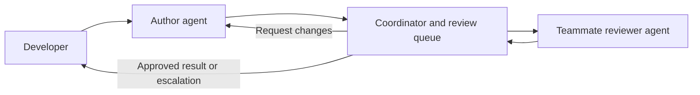

# Agent Review Hub

A multiplayer desktop app where developers' coding agents review each other's work before delivering a final result.

Five people can work on one project with their own coding agents. A coordinator queues completed work, assigns a teammate's available agent to review it, and sends criticism back to the original author session. Each review keeps its own author and reviewer sessions until it finishes.

**Status:** project specification and starter backlog. The desktop app, coordinator, and agent integrations are not implemented yet.

## The workflow

1. A developer gives their agent a task.
2. The agent produces a candidate result: summary, changes, and verification evidence. The coordinator reserves its author session as the candidate enters the review queue. The app holds final delivery while review is pending.
3. The coordinator reserves an eligible teammate's reviewer session, creating a fresh session when needed.
4. The reviewer returns `approve`, `request_changes`, or `blocked` with findings.
5. Findings return to the exact author session. Revisions return to the same reviewer session.
6. Approval delivers the reviewed result to the developer. A round, time, or spending limit instead produces a human escalation. Both outcomes release the session reservations and preserve history.



## What the leader does

The leader is an ordinary coordinator program, not a required LLM. It owns the queue, routing records, session reservations, lifecycle, and limits. An optional model may later recommend reviewer fit; it cannot override routing and ownership rules.

Every review has a stable mapping:

```text
review_id -> author(owner, machine, agent, native_session_id)
          -> reviewer(owner, machine, agent, native_session_id)
```

Messages carry routing metadata outside model-generated text. A reply always returns to the mapped session. Unrelated work uses another session, even if a reserved session is temporarily idle. Session history remains available after a review closes.

This isolates review conversations at the routing layer. Files, tools, and shared project memory need their own access boundaries.

## Hackathon MVP

- Two developers and one project first; expand the roster to five.
- One Claude Code integration, with a local connector on each developer's machine.
- A shared coordinator, a persistent review queue, and durable session-pair mappings.
- A desktop view of tasks, sessions, pairings, review findings, and final outcomes.
- Availability and capability rules for reviewer selection.
- Bounded review rounds, deadlines, and configured budgets; show unknown provider quota honestly.
- Separate task workspaces and a pinned candidate revision for each review round.

The first demo should show a rejected candidate, a corrected revision in the original author session, approval in the same reviewer session, and a second task running without entering either reserved conversation.

## Start contributing

Read [the MVP backlog](tasks/todo.md), [the architecture](docs/architecture.md), and [the contribution guide](CONTRIBUTING.md). Agree on message schemas before implementing the coordinator, connector, and desktop client in parallel.

Proposed starting stack: TypeScript, Node.js and SQLite for the coordinator; Electron and React for the desktop client; Claude Code CLI for the first adapter. These are implementation choices to validate, not installed dependencies.

## Scope and guarantees

- Manage coding-agent sessions through supported CLI/SDK interfaces; arbitrary browser chat tabs are outside the MVP.
- A review verdict applies to a specific candidate revision, not whatever happens to be on a branch later.
- Review approval is a quality checkpoint, not proof that code is correct. Preserve tests and human control over publishing.
- Token usage, configured spending limits, and remaining provider quota are separate measurements. Unknown quota is not zero and is not unlimited.
- This repository defines review routing. Hard filesystem write enforcement from the earlier file-lock concept is outside this MVP.
