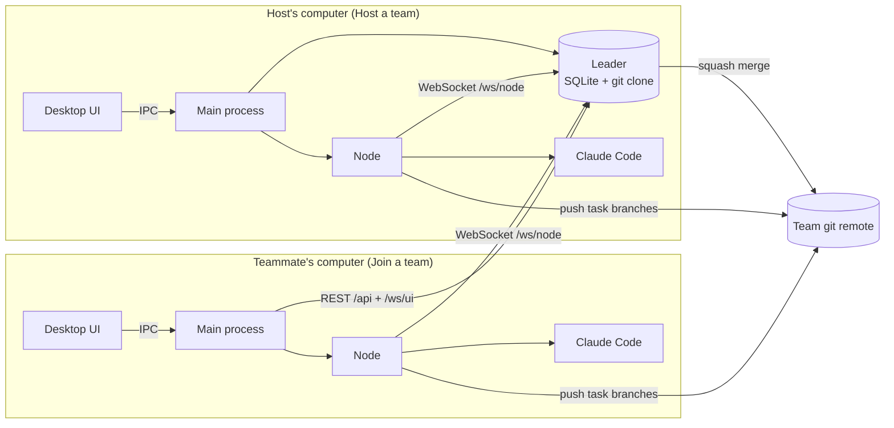
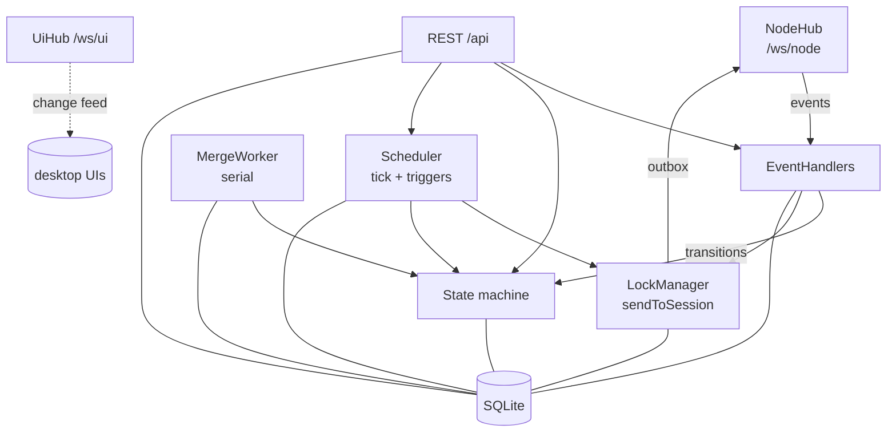
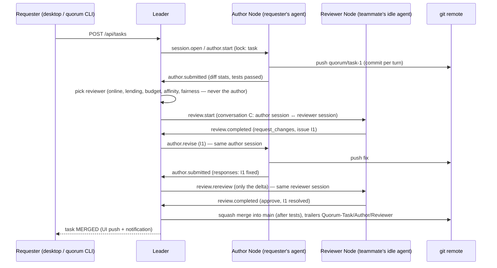

# Architecture

How Quorum is built, as of v0.2.0. The normative design (every rule, limit and edge case) is
[`implementation-spec.md`](implementation-spec.md); this page is the map. User-facing setup is in [`INSTALL.md`](INSTALL.md).

## The idea in one paragraph

Every teammate runs the desktop app, which runs a **Node** that drives that person's coding agent (Claude Code,
opencode, or a mock for tests). One teammate's app also runs the **Leader**: the team's coordinator and the only
writer of `main`. Tasks are authored on a branch by the requester's agent, reviewed by a different teammate's idle
agent, revised until approved, tested, and squash-merged. The Leader is ordinary deterministic code — it makes no LLM
calls.

## Packages

| Package | Role |
|---|---|
| [`packages/protocol`](../packages/protocol/src) | The shared contract (zod schemas + TS types): configs, WebSocket frames, commands and events, the JSON blocks agents must emit, the REST route table `API_ROUTES`, UI events. Every other package imports it; nothing redefines wire types. |
| [`packages/leader`](../packages/leader/src) | The coordinator: SQLite state, task state machine, locks and leases, event handlers, scheduler, merge worker, REST + WebSocket server, `quorum-leader` CLI. |
| [`packages/node`](../packages/node/src) | Runs on each teammate's machine: git worktrees, a durable journal, prompts and output parsing, agent adapters, the reliable Leader client, the command runner, `quorum-node` CLI. |
| [`packages/desktop`](../packages/desktop/src) | Electron + React app. Its main process embeds the Node (always) and the Leader (Host mode); the renderer is the UI. Also installer packaging. |
| [`packages/cli`](../packages/cli/src) | `quorum`, a CLI for coding agents and scripts, using requester-scope API tokens. |
| [`e2e`](../e2e) | End-to-end scenarios: a real Leader and real Nodes with scripted mock agents against real git. |

## Deployment: Host and Join

* **Join codes are the only way in.** The host's app creates one per teammate: `quorum1.` + base64url JSON of
  `{leaderUrl, agentId, ownerName, token, repoRemoteUrl}`. There is no discovery; a teammate's app connects to exactly
  the address in its code.
* **Reaching the host.** In Host a team the app lists this computer's addresses labelled by network (local network,
  Tailscale incl. its MagicDNS name, ZeroTier, WireGuard, other VPN) or takes a custom address / `https://` tunnel URL
  (→ `wss://`). *Only accept connections through this address* binds the Leader to that IP. Quorum works with any VPN
  and never installs or controls one.
* **Connections always go Node → Leader** (machines behind NAT need no inbound ports except the host).
* The desktop renderer never sees a token: REST calls and the `/ws/ui` stream are proxied by the main process.
* Headless alternative: `quorum-leader start` and `quorum-node start` run the same code without a GUI.

## The Leader

| Module | Responsibility |
|---|---|
| `db/` | Schema (agents, sessions, tasks, conversations, issues, messages, task_events, usage_ledger, directives, merge_queue, api_tokens), migrations, a typed repo, `withTx` (synchronous transactions with after-commit hooks). |
| `core/state-machine.ts` | The task lifecycle as a data table (spec §8.2, T1–T33). Every transition is validated and writes an audit row in the same transaction. |
| `core/locks.ts` | Locks a session to exactly one task or directive; `sendToSession` refuses any command whose task/directive/role/conversation doesn't match the lock, assigns per-conversation sequence numbers and writes the command to the outbox. |
| `ws/node-hub.ts` | Authenticates Nodes, delivers commands reliably (resend until acked), deduplicates events, acks only after the handling transaction commits, extends leases from heartbeats, records events for unknown sessions instead of disconnecting, and acks repeatedly failing ("poisoned") events after 5 attempts. |
| `core/handlers.ts` (+ `commands.ts`, `review.ts`, `usage.ts`) | One handler per Node event: stale-event guards, issue bookkeeping and the effective verdict, test failures, `turn.failed` policy (retries, rate limits, git errors), usage ledger, command builders. |
| `core/scheduler.ts` (+ `budget.ts`) | Assigns authors and reviewers, opens or reuses sessions, runs directives, expires leases, resumes or requeues paused tasks, raises needs-attention notices, closes idle sessions. |
| `core/merge-worker.ts` + `git/leader-git.ts` | Serial squash merges into `main` from the Leader's own clone; runs the project's tests first. |
| `api/routes.ts` + `api/views.ts` | Every `API_ROUTES` endpoint with bearer auth, requester/admin permissions and schema-validated responses. |
| `ws/ui-hub.ts` | `/ws/ui`: pushes `task.updated`, `task.event`, `agent.updated`, `directive.updated`, `task.needs_attention` to connected UIs. |
| `core/api-tokens.ts` | Requester-scope tokens for the `quorum` CLI (can create tasks, answer blocked authors, read and ask — never approve, cancel, pause, reassign or merge). |

On start the Leader marks every agent offline until it says hello, and puts any task left in `MERGING` back into the
merge queue.

## The Node

* **Workspace.** One base clone plus one git **worktree per session**, fixed for the session's lifetime (Claude Code
  resumes sessions by working directory). Branch `quorum/task-<id>` per task.
* **Journal** (SQLite): inbox/outbox of frames and the session list — commands survive a restart; a command that was
  running when the Node died is reported back as `turn.failed {INTERRUPTED}`.
* **Leader client.** Reconnects with backoff, sends hello (settings + live sessions) and heartbeats (idle time, rate
  limit, sessions, context size), resends unacked events, deduplicates commands.
* **Command runner.** One command at a time per session, sessions in parallel. For each turn: prepare git → build the
  prompt → run the agent → parse the trailing `quorum-json` block (re-prompt on invalid output) → commit and push
  (authors only; agents never run git themselves) → run the project's `testCommand` from `main`'s `quorum.json` →
  emit the result event. Compacts a session (summary → fresh native session, same `sid`) when its context fills up.
* **Adapters** share one interface (`createSession`, `runTurn`, `closeSession`):
  * **Claude Code** via the Agent SDK. Every tool call goes through `canUseTool`: paths must stay inside the worktree;
    reviewers and directives are read-only; authors get an allow-listed Bash; git writes are always denied; user
    settings are not loaded. The bundled per-platform Claude Code CLI is resolved explicitly (works from
    `app.asar.unpacked`).
  * **opencode** over its HTTP server.
  * **Mock**, scripted from JSON — used by e2e tests and demos.

## Life of a task

States (spec §8.1): `QUEUED → AUTHORING → AWAITING_REVIEWER → IN_REVIEW → MERGE_QUEUED → MERGING → MERGED`, with
`SYNCING` (merge `main` into the branch after a merge conflict), `PAUSED` (author unavailable, rate-limited, or paused
by a human), `ESCALATED` (a human must decide: round or dispute limit, failing tests, blocked author), and the terminal
`CANCELLED` / `FAILED`.

Rules that make it converge:

* The Leader computes the **effective verdict** from open blocking issues; a reviewer's stated "approve" doesn't
  override an issue it left open. Suggestions never block.
* `system` issues (test failures) are resolved by the Leader when tests pass; reviewers never see them.
* Round and dispute limits escalate to a human instead of looping.
* Failing tests return the task to its author before any reviewer spends tokens.

## How conversations stay paired

The guarantees behind "messages never leak between tasks":

1. **One lock per session.** A session row holds at most one `(kind, ref, role)` lock; it is released only when the
   task finishes (or on explicit reassignment). A locked session never receives unrelated work.
2. **One gate for sending.** Every command goes through `sendToSession`, which checks the lock, the role, and — for
   review traffic — that the session is a participant of the task's *active* conversation.
3. **Conversations are immutable pairs.** A conversation binds exactly one author session and one reviewer session
   (on different agents). If either side is lost, the conversation is abandoned and a new one is created; it is
   never rewired.
4. **Sessions keep their role.** A session opened as a reviewer (read-only tools) is never reused for author work, or
   vice versa.
5. **Stale replies are ignored.** A result is applied only if it answers the session's latest command, the task is in
   the expected state, and (for reviews) it reviews the current head commit.
6. **Leases.** Locks expire unless the Node's heartbeat renews them; an expired lock is treated as a lost session.

## Choosing agents and sessions

* **Author:** the requester's own agent (`own` mode, default) or any lending agent (`pool` mode).
* **Reviewer:** hard filters (online, not the author, not rate-limited, has a free slot, lend mode allows it — e.g.
  *only when idle* — and enough of the owner's daily token budget for teammates), then a score of file affinity,
  budget headroom, idleness, expertise tags, minus pair and fairness penalties. An agent that already dropped the
  task's review is used only if nobody else qualifies.
* **Session:** reuse an idle session of the same role with enough overlap with the task's files (a never-used one
  always qualifies) and room in its context window; otherwise open a new one.

## Wire protocol and API

* **`/ws/node`** — JSON frames: `hello`/`welcome`/`reject`, `heartbeat`, `cmd` (Leader → Node), `evt` (Node → Leader),
  `ack`. Both directions are at-least-once with deduplication by `msgId`; commands carry per-conversation `seq`.
* **REST `/api/*`** — the table in [`protocol/src/api.ts`](../packages/protocol/src/api.ts): tasks (create, list,
  detail, diff, approve, send back, answer, reassign reviewer, pause/resume, cancel), agents, sessions, team
  activity, directives, API tokens. Bearer auth; agent tokens and requester API tokens.
* **`/ws/ui`** — change notifications for the desktop UI.

## Security model

* Tokens are random, stored only as SHA-256 hashes on the Leader and encrypted with the OS keychain in the app.
* Agent-to-agent text is wrapped as untrusted `<peer_content>` in prompts; the real enforcement is in code
  (`canUseTool`), not in the prompt.
* Only the Leader writes `main`; Nodes push only `quorum/task-*` branches; agents never run git themselves.
* The Leader speaks plain HTTP/WebSocket: use it on a LAN or VPN, or behind an `https://` tunnel or TLS proxy (`wss://`).
* `quorum.json` (setup and test commands) is always read from `main`, never from a task branch.

## Testing

* Unit tests per package (`pnpm -r test`): state machine, locks, handlers, scheduler, merge worker against real git,
  REST API against a live Leader, Node runner and adapters, desktop services including real LAN joins.
* End-to-end (`pnpm e2e`): real Leader and Nodes with mock agents covering review rounds, limits, disconnects, rate
  limits, budgets, lend modes, conflicts, Leader restarts, directives, cancellation, compaction and blocked authors.
* CI runs both on every PR; the Release workflow builds Linux, macOS and Windows installers on version tags.
